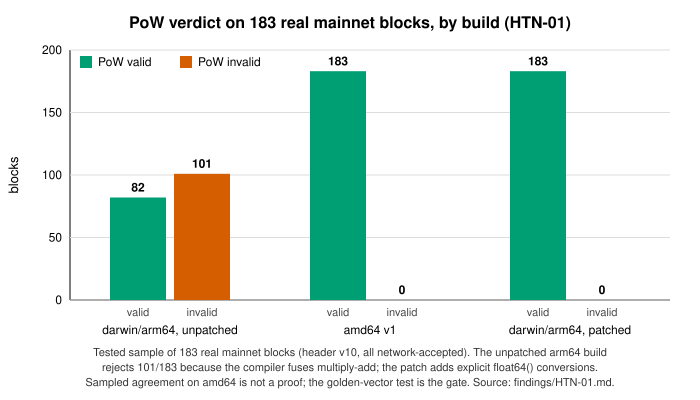

# HTN-01 — Hoohash v1.1.0 PoW evaluates differently on builds where the compiler fuses multiply-add

| Severity | Category | Evidence level | Chain impact | Proposed action | Status | Upstream |
|---|---|---|---|---|---|---|
| High | consensus | Reproduced | none | PR | Merged 2026-10-17 into 2.18.3 (dd7bd9067) and bridge 1.8.2 (99f98500a) | PR [HTND#35](https://github.com/HoosatNetwork/HTND/pull/35), [bridge#10](https://github.com/HoosatNetwork/htn-stratum-bridge/pull/10) |

## Summary

Go fuses `x*y+z` into a fused multiply-add on arm64 and on amd64 with `GOAMD64>=v3`, but not on amd64 v1.
HoohashV110 (block version >= 5) therefore produces a different PoW value on pure-Go arm64 builds. The macOS release
asset is built on an arm64 runner and uses the Go PoW path, so a node or bridge running that asset disagrees with the
network on which blocks are valid, including the v2.18.1 `osx.zip` (binary untested).

## Affected code

Paths and lines refer to HTND `a56566e86` (branch v2.18.1) unless stated otherwise.

- `domain/consensus/utils/pow/heavyhash.go:429-440` (fusion sites), `TransformFactor`, `ForComplex`
- `domain/consensus/utils/pow/pow.go` build tag (Go path on every target except linux/arm64+cgo)
- `.github/workflows/deploy.yaml:19` (`macos-latest` runner)
- Bridge: `htn-stratum-bridge/src/pow/heavyhash.go` @3b2cf8c (same code)

## Impact

A node on an affected build rejected 101/183 blocks in the tested sample and would not follow the chain; a bridge on
such a build marks valid shares invalid. The fix changes PoW validity on affected builds; universal compatibility of
the patched code across all platforms is not proved by the sample, which is why the vector test is the gate.

## Evidence

- 183 consecutive real mainnet blocks (header v10, all network-accepted; block hashes re-derived and matched 183/183):
  unpatched darwin/arm64 rejects **101/183**; amd64 v1 accepts 183/183; patched arm64 accepts 183/183. Re-run
  independently by the second reviewer.
- `go tool objdump`: 6 fused ops on arm64, 0 on amd64 v1, 1 on amd64 v3; 0 everywhere after the patch.
- Synthetic: 3000 inputs, 2183 differ arm64 vs amd64 before, 0 after; amd64 v1 output is bit-identical before and after
  (sampled agreement, not a proof).
- Reproducer: `go test -count=1 -run TestS5RealMainnetBlocks ./domain/consensus/utils/pow/` with the 183-block vector file.

## Recommendation

Wrap six expressions in explicit `float64()` conversions (about 15 changed lines; the Go specification says an explicit
conversion rounds and prevents fusion). Add `pow/testdata/hoohash_v110_mainnet_vectors.json` (183 headers -> expected
value) and a test asserting the exact value for every vector. Same patch and test for the bridge. Target: master plus a
v2.18.1 backport; a compatibility fix that need not wait for an activation window.

## Verification

**Completed:** golden-vector probe on darwin/arm64 (101/183 mismatches before, 0 after) and amd64 v1 (183/183 before and after); re-run by the second reviewer.

**Required before submission:** the upstream test asserting exact values per vector, shipped in the PR with the vector file; the CI matrix (HTN-24); runs on linux/arm64 (C path) and `GOAMD64=v3` hardware.

## Chain impact

None for the network. The change corrects PoW evaluation only on builds that already disagree with the chain. No halt, no rollback.

## Related items

[HTN-24](HTN-24.md), [HTN-16](HTN-16.md), [HTN-37](HTN-37.md)

## Upstream

PR [HTND#35](https://github.com/HoosatNetwork/HTND/pull/35) and [bridge#10](https://github.com/HoosatNetwork/htn-stratum-bridge/pull/10) — in review.

