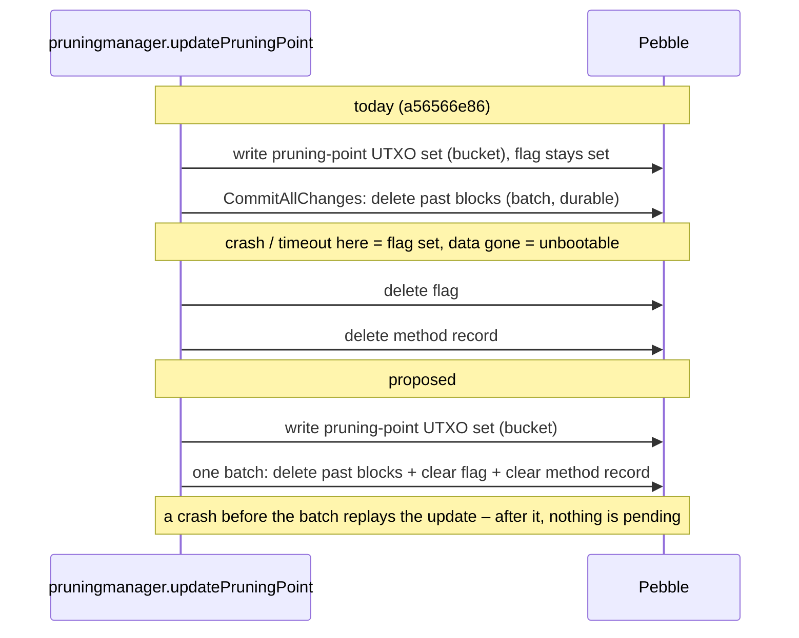

# HTN-02 — Pruning-point update deletes past blocks before clearing its in-progress flag

| Severity | Category | Evidence level | Chain impact | Proposed action | Status | Upstream |
|---|---|---|---|---|---|---|
| High | storage | Reproduced | none | PR | Merged 2026-10-13 into 2.18.2 (8b666d5af) — released in v2.18.2 (16 October 2026) | PR [HTND#38](https://github.com/HoosatNetwork/HTND/pull/38) |

## Summary

`updatePruningPoint` commits the deletion of past blocks (`CommitAllChanges`) and only afterwards deletes the
`updatingPruningPointUTXOSet` flag and the method record (two separate deletes). A crash, a shutdown timeout or a lost
NoSync write between the two leaves the flag set while the data it refers to is gone. On restart
`UpdatePruningPointIfRequired` fails with `blockHash is nil` and the node cannot start without a reset.

## Affected code

Paths and lines refer to HTND `a56566e86` (branch v2.18.1) unless stated otherwise.

- `domain/consensus/processes/pruningmanager/pruningmanager.go` — `updatePruningPoint` (commit at ~:2621, finish at ~:2635), diff walk `:1335`
- `domain/consensus/datastructures/pruningstore/pruning_store.go:348-357` (`FinishUpdatingPruningPointUTXOSet`)
- `domain/consensus/factory.go:674` (startup call)
- Same ordering exists in kaspad (inherited).

## Impact

A node that dies in this window is unbootable and needs a full reset and IBD, matching the operator experience that
"only a reset helps". Pruning-point moves recur every few hours.

## Evidence

- Reproducer `TestS2ResumeAfterDeletionCommitted` (`go test -count=1 -run TestS2ResumeAfterDeletionCommitted ./domain/consensus/`):
  previous pruning point `HeaderOnly`, then `UpdatePruningPointIfRequired` returns `blockHash is nil`
  (`ghostdag_data_store.go:58` <- `pruningmanager.go:1335`), on both test-network configurations.
- Confirmed by the second reviewer. Note: the fixture shrinks network parameters so that deletion actually happens; it is
  not a production-parameter crash replay.
- Fault model ([reports/db-recovery.md](../reports/db-recovery.md)): an OOM kill under NoSync can lose unflushed WAL
  data queued in user space, which pebble treats as a truncated tail of the newest WAL. If that data includes the
  commit that clears the flag, the node is in this state. The cause of our own past incidents is unknown (no pebble
  error line was kept); this finding is a plausible candidate, not an established cause. The move is also the node's
  memory peak ([reports/memory-test.md](../reports/memory-test.md)).

## Recommendation

Stage both deletions in the pruning staging shard so that they land in the same batch as `deletePastBlocks`. No key
format change. As a **separate** follow-up (it adds a startup acceptance path): if the recorded method's data is missing
and the previous pruning point is `HeaderOnly`, validate the already-written UTXO bucket with the existing commitment
check and finish on success, otherwise fail with "resync required" naming the pruning point. That recovery design is
unverified and needs negative tests (commitment mismatch, partial bucket, wrong method record) first.

## Verification

**Completed:** reproducer fails on both test-network configurations; confirmed by the second reviewer.

**Required before submission:** an injected-stop acceptance test showing the state is unreachable after the change; existing pruning tests pass; negative tests for the follow-up recovery design.

## Chain impact

None (node-local). Same keys, same consensus.

## Related items

[HTN-11](HTN-11.md), [HTN-05](HTN-05.md), [HTN-27](HTN-27.md), [HTN-03](HTN-03.md), [HTN-40](HTN-40.md)

## Upstream

PR [HTND#38](https://github.com/HoosatNetwork/HTND/pull/38) — merged, released in v2.18.2.

_AI disclosure: prepared with AI assistance (Claude by Anthropic; cross-reviewed with OpenAI Codex)._
