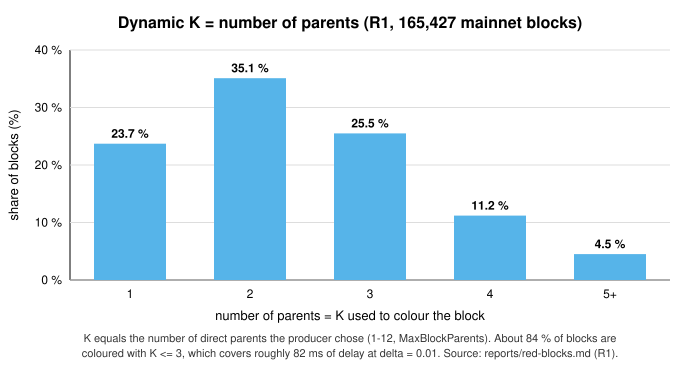
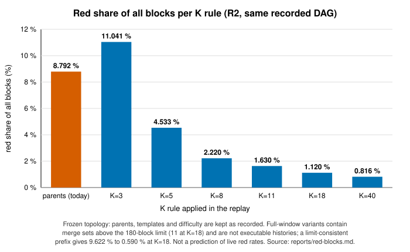

# HTN-04 — GHOSTDAG K equals the block's parent count; a version-gated K floor should be studied

| Severity | Category | Evidence level | Chain impact | Proposed action | Status | Upstream |
|---|---|---|---|---|---|---|
| Medium | consensus | Reproduced (mechanism; operational security impact unverified) | version-gated forward fork | Issue | Draft — not yet submitted | TBD |

## Summary

From block version 6, `dynamicKForBlock` returns `CalculateRank(parents, parents)`. Parents form an antichain
(v10+), so the rank is the number of parents (1-12). GHOSTDAG's "honest blocks are blue" bound needs K at least the
Poisson tail of `2*D*lambda`; K=3 covers about 82 ms of delay at delta=0.01, while Kaspa's formula gives 67 at 5 BPS.
The static K=40 still sets the pruning depth. The mechanism is reproduced; the operational security impact is
unverified, which is why this is rated Medium despite the consensus category.

## Affected code

Paths and lines refer to HTND `a56566e86` (branch v2.18.1) unless stated otherwise.

- `domain/consensus/processes/ghostdagmanager/ghostdag.go:84-92, 200-219`
- `domain/consensus/processes/ghostdagmanager/dagknight.go:472-561, 660, 797-801`
- `domain/dagconfig/params.go` (`MaxBlockParents=12`; static K=40 at `:528-541` used for pruning depth)

## Impact

Under higher load, more decentralised mining or adversarial delay, honest parallel blocks turn red and the share of
honest work counted in chain selection falls. Pruning/finality constants are unchanged; their implications need separate analysis.

## Evidence

- `TestS4RankEqualsParentCount`: rank == |parents| for 1806/1806 parent sets (re-run by the second reviewer).
- Live K histogram (~200,000 accepted blocks, two nodes): K=1 24 %, K=2 36 %, K=3 26 %.
- R1: 8.71 % of all blocks red (14.69 % of parallel blocks) over 165,427 blocks in a ~9 h window.
- R2 (`reports/red-blocks.md`): an independent replay reproduces the node's colouring exactly after warm-up. At fixed
  topology, K=18 changes the red share from 8.792 % to 1.120 % (that full replay contains 11 mergesets above the
  180-block limit); a limit-consistent prefix changes 9.622 % to 0.590 %. This does not predict live red rates, does
  not separate the causal shares of K, topology and delay, and establishes no attack threshold.

## Recommendation

Options: (a) retain the current rule and document the uncertainty; (b) study a version-gated K floor
(`k = max(|parents|, K_min)`) with regenerated valid histories and testnet trials. Recommendation: (b), without
scheduling an activation. Decision requested: approve the study; agree target delay, failure probability and acceptance criteria.

## Verification

**Completed:** `TestS4RankEqualsParentCount`; R2 replay validation against the node's colouring.

**Required before submission:** for the study: a two-branch fork merged by a 2-parent block is red at K=2 today and blue at K >= K_min; controlled delay simulations; testnet trial before any activation.

## Chain impact

Option (b) is a forward hard fork, version-gated at a future DAA score; the chain keeps running. Re-colouring existing history is rejected (it would need a rollback).

## Related items

[HTN-36](HTN-36.md), [HTN-13](HTN-13.md), [HTN-14](HTN-14.md), [HTN-38](HTN-38.md)

## Upstream

TBD — PR/issue link to be filled in once submitted.

