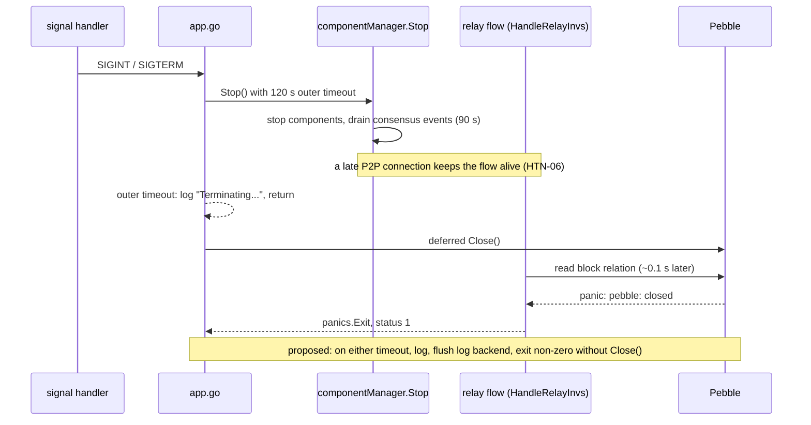

# HTN-05 — Database is closed under active users when graceful shutdown times out

| Severity | Category | Evidence level | Chain impact | Proposed action | Status | Upstream |
|---|---|---|---|---|---|---|
| Medium | availability | Measured | none | PR | Merged 2026-10-12 into 2.18.2 (c36ba8c3d) — released in v2.18.2 (16 October 2026) | PR [HTND#37](https://github.com/HoosatNetwork/HTND/pull/37) |

## Summary

Two paths close the database while flows may still use it: (1) the outer 120 s timeout in `app.go` logs
"Terminating..." and returns, so the deferred `Close()` runs while `componentManager.Stop` continues; (2) the 90 s
consensus-event drain times out, `Stop` returns normally, and the database is closed under a surviving handler even
without the outer timeout. Pebble v2 panics on use after Close; the process exits 1.



## Affected code

Paths and lines refer to HTND `a56566e86` (branch v2.18.1) unless stated otherwise.

- `app/app.go` (outer 120 s timeout, deferred database Close)
- `app/component_manager.go:151-155` (90 s event drain)
- Related upstream PR #25 (older base) changes the first path only.

## Impact

A slow shutdown ends in a panic rather than a clean exit. The WAL makes this survivable, but recent acknowledged
NoSync writes can be lost, and the unclean exit widens the window of HTN-02.

## Evidence

Observed on a production node (6 vCPU / ~11 GiB KVM, SSD; HTND 2.18.1-a56566e86, default flags) during a planned
restart: blocks were still being accepted from outbound peers up to the timeout, then (address-stripped excerpt):

```
[CRT] HSATD: Graceful shutdown timed out 2m0s. Terminating...
[INF] HSATD: htnd shutdown complete
[INF] HSATD: Gracefully shutting down the database...
(+0.108 s) [CRT] PROT: Exiting: Fatal error in goroutine `flow-HandleRelayInvs ...`: pebble: closed
```

Exit status 1; WAL replayed on restart; no corruption. Path (1) code-confirmed; path (2) found by the second review.

## Recommendation

Draft PR (revised after review): `ComponentManager.Stop` reports whether everything finished (`false` on a
drain timeout). A new `stopComponents` in `app.go` exits through `panics.Exit` (critical log, log flushed,
status 1) when `Stop` reports `false` or does not return within 120 s, so the deferred database
`Close` never runs under live users. Timeouts are unchanged; a clean shutdown still closes the database and exits 0. For the
database this exit equals a crash, as every panic exit is today. Upstream PR #25 covers path (1) only; either can land first.
Maintainers may prefer PR #25's exit code 2 (one line).

## Verification

**Completed:** incident observation on our node; `TestShutdownTimeoutDoesNotCloseDatabase` (subprocess cases: clean
stop, stuck `Stop`, stuck drain) and `TestStopReportsConsensusEventsDrainTimeout` (real `ComponentManager` on a
temporary database) fail on v2.18.1 head `fcef4aede` with a shim that keeps its behaviour and pass on the branch,
also `-race -count=20`; a mutation check makes the second test fail; integration tests pass.

**Required before submission:** maintainer choice of exit code; rebase if PR #25 lands first.

## Chain impact

None (node-local). Exit code changes; systemd restarts either way.

## Related items

[HTN-06](HTN-06.md), [HTN-41](HTN-41.md), [HTN-35](HTN-35.md), [HTN-27](HTN-27.md)

## Upstream

PR [HTND#37](https://github.com/HoosatNetwork/HTND/pull/37) — merged, released in v2.18.2.

_AI disclosure: prepared with AI assistance (Claude by Anthropic; cross-reviewed with OpenAI Codex)._
