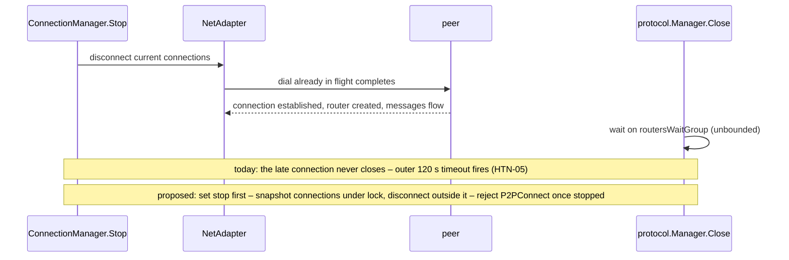

# HTN-06 — NetAdapter accepts new P2P connections while stopping; shutdown can hang

| Severity | Category | Evidence level | Chain impact | Proposed action | Status | Upstream |
|---|---|---|---|---|---|---|
| Medium | availability | Reproduced | none | PR | Merged 2026-10-12 into 2.18.2 (717a3366c) — released in v2.18.2 (16 October 2026) | PR [HTND#40](https://github.com/HoosatNetwork/HTND/pull/40) |

## Summary

`ConnectionManager.Stop` disconnects current connections, but a dial in flight completes afterwards.
`NetAdapter.Stop` stops the gRPC *servers* only; `P2PConnect` and `onP2PConnectedHandler` have no stopped guard, and
`protocol.Manager.Close` waits without bound on the router wait group. The shutdown then hangs until the outer timeout
(HTN-05).

## Affected code

Paths and lines refer to HTND `a56566e86` (branch v2.18.1) unless stated otherwise.

- `infrastructure/network/connmanager/connmanager.go:91-101`, `outgoing_connections.go:36-50`
- `infrastructure/network/netadapter/netadapter.go:107-115`
- `app/protocol/manager.go:45-53`, `app/protocol/protocol.go:34-38, 97-107`

## Impact

Every planned restart risks a 2-minute hang followed by the unclean exit of HTN-05.

## Evidence

- Two reproducers fail on unmodified v2.18.1: a connection dialed after `ConnectionManager.Stop`'s sweep survives
  `NetAdapter.Stop` and still receives a Ping; `P2PConnect` after `NetAdapter.Stop` succeeds and leaves a live
  connection. A third: a router initialised just before `protocol.Manager.Close` panics ("tried to initialize router
  when the protocol manager is closed"), which exits the process with status 1.
- The production incident in HTN-05 is consistent with this race; causality is not established.
- Upstream PR #25 adds a disconnect sweep but no dial guard, on a base about 330 commits behind.

## Recommendation

Draft PR (revised after review): `Stop` sets the stopped flag first, snapshots the connections under
`p2pConnectionsLock` and disconnects them **outside** the lock; `P2PConnect` refuses to dial once stopped;
`onP2PConnectedHandler` rejects a late connection before its router is initialised and checks the flag again under the
lock just before registering it; the flows goroutine returns instead of panicking when it starts after `Close`. Two
pre-existing hazards are left for separate changes and stated in the PR: `routersWaitGroup.Add` inside the spawned
goroutine, and unsynchronised disconnect-handler fields.

## Verification

**Completed:** four tests fail on v2.18.1 head `fcef4aede` and pass on the branch (`-race -count=50`):
`TestOutboundConnectionDialedDuringStopDoesNotSurviveShutdown` (loopback gRPC), `TestStopDisconnectsOutboundConnections`
and `TestP2PConnectionIsRejectedOnceStopping` (no sockets), `TestRouterInitializedAfterCloseDoesNotPanic`. The
socket-free tests were adapted from the second review, so they no longer depend on bind permissions; no test sleeps.
Integration tests pass; no merge conflict with master `c097146c6`.

**Required before submission:** none beyond the shared shutdown-series review; rebase onto PR #25 if it lands first.

## Chain impact

None (node-local).

## Related items

[HTN-05](HTN-05.md), [HTN-41](HTN-41.md)

## Upstream

PR [HTND#40](https://github.com/HoosatNetwork/HTND/pull/40) — merged, released in v2.18.2.

_AI disclosure: prepared with AI assistance (Claude by Anthropic; cross-reviewed with OpenAI Codex)._
