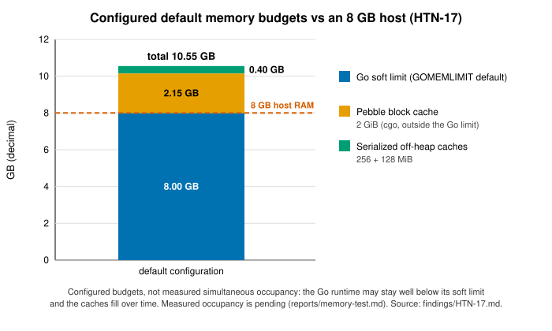

# HTN-17 — Memory budget is not derived from host RAM

| Severity | Category | Evidence level | Chain impact | Proposed action | Status | Upstream |
|---|---|---|---|---|---|---|
| Medium | memory | Measured | none | Issue | Draft — not yet submitted | TBD |

## Summary

The default `GOMEMLIMIT` of 8 GB, a 2 GiB Pebble cache (cgo, outside the Go limit) and about 384 MiB of off-heap
caches are configured budgets that can exceed available RAM on an "8 GB" host; they are not measured simultaneous occupancy. About 28 `HTND_*` knobs exist but no single budget (rusty-kaspa has
`--ram-scale`).

## Affected code

Paths and lines refer to HTND `a56566e86` (branch v2.18.1) unless stated otherwise.

- `main.go:27` (`GOMEMLIMIT` default), `app/app.go:27, 203` (Pebble cache), `domain/consensus/factory.go:786-791` and
  `domain/consensus/utils/lrucache/offheap.go` (off-heap cache budgets)

## Impact

Measured: with default settings under a 7 GiB cap (about what an 8 GB host leaves for `htnd`) the node was OOM-killed
three times in about 10.6 h; operators have no single knob to size the node. Severity Medium (degraded availability):
each time the process restarted within about 10 s and an interrupted pruning-point update resumed without corruption,
so the High criterion (unusable without reset or resync) was not met. A kill in that window is the HTN-02 risk.

## Evidence

`main.go:27` sets an 8,000,000,000-byte soft Go limit; `app/app.go:27, 203` supplies a 2 GiB Pebble cache;
`factory.go:786-791` defines 256/128 MiB serialised-cache budgets. These are configured budgets that can exceed available
RAM; they are not measured simultaneous occupancy. Two-node memory test (`reports/memory-test.md`): two identical VPS
(6 vCPU / ~11 GiB, no swap), same binary, mainnet; node A with `--utxoindex`, node B without; about 10.6 h uncapped,
then about 10.6 h under `MemoryMax=7G` + `MemorySwapMax=0`. Pre-registered T1 (zero OOM kills) is rejected: node A 2,
node B 1. One kill came with no pruning-point move running (anonymous memory crept to 6.98 GiB while page cache was
squeezed to zero); two came on both nodes during the same move's deletion → commit step. The Go soft limit sits above
the cap, so GC does not react, and Pebble's cache is outside the Go heap.

## Recommendation

Options: (a) do nothing; (b) one knob with defaults derived from cgroup/host RAM, capped at today's values.
Recommendation: (b), derive `GOMEMLIMIT` and the Pebble cache from host/cgroup memory. Phase C′ (same cap, Pebble cache 1 GiB,
`GOMEMLIMIT=3584MiB`): no OOM kill in 14.1 hours and five moves ([memory test](../reports/memory-test.md)). Decision requested: accept RAM-derived defaults?

## Verification

**Completed:** code read; the deterministic T4 test (HTN-08); memory-test phases A and B (T1 rejected); phase C′
(memory met, sync not).

**Required before submission:** the `GOMEMLIMIT=5GiB` follow-up against its pre-registered criteria (zero OOM kills, synced >= 99 % of samples); a test of the derived defaults on a capped host.

## Chain impact

None (node-local).

## Related items

[HTN-08](HTN-08.md), [HTN-02](HTN-02.md)

## Upstream

TBD — PR/issue link to be filled in once submitted.

