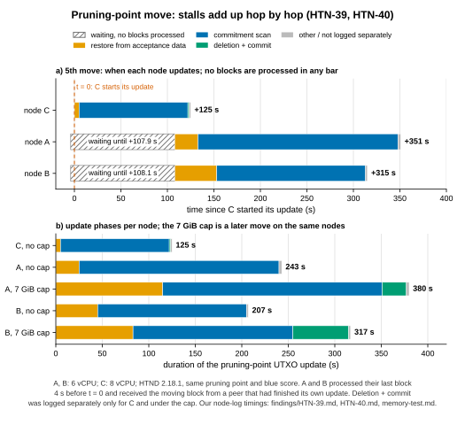

# Two-node memory test of HTND 2.18.1 — protocol summary

**Phases A and B are complete (about 10.6 hours each); results are below. T1 is rejected: three OOM kills under the
7 GiB cap with default settings. The follow-up with a 1 GiB Pebble cache and a 3.5 GiB Go memory limit (phase C′)
had no OOM kills in 14 hours.** This page records the protocol as
locked before phase B, an interim observation made during phase B, and the results judged against the pre-registered
criteria. Related findings: [HTN-17](../findings/HTN-17.md) (memory budget), [HTN-08](../findings/HTN-08.md)
(unused caches), [HTN-40](../findings/HTN-40.md) (pruning-point move).

## Goal

Measure reproducibly (1) how much memory and CPU a non-archival HTND 2.18.1 node needs, (2) whether it runs without
crashing on an 8 GB host with default settings, and (3) which parts of the code use memory without need.

## Fixed conditions

| Factor | Value |
|---|---|
| Software | HTND 2.18.1-a56566e86 (branch v2.18.1), the same binary on both nodes |
| Hardware | two identical VPS: 6 vCPU, ~11 GiB RAM, SSD, no swap |
| Settings | identical except for the studied variables; pprof bound to localhost only |
| Network | mainnet; both nodes measured at the same time, so network load is the same for both |
| Clock | NTP-synchronised; offset 0.1–8 ms (the protocol tolerates about 26 s on block timestamps) |
| Sampling | every 15 min on both nodes simultaneously, plus a 5 s fast sampler added during phase A |

## Variables

- **Independent:** `--utxoindex` (node A on, node B off) × memory limit (phase A none, phase B `MemoryMax=7G` +
  `MemorySwapMax=0`).
- **Dependent:** RSS, cgroup anon/file/current, Go `Sys`/`HeapAlloc`, approximate off-heap share
  (RSS − (Sys − HeapReleased)), CPU cores averaged per interval and 5 s peaks, GC CPU share (per-interval deltas),
  goroutines, `memory.events` (high/max/oom/oom_kill), PSI memory/IO pressure, host steal time, sync state (DAA score vs
  the other node), restarts. Heap profiles every 15 min.
- **Confounders:** pruning-point moves (~3.3 h apart) analysed as separate peaks; both phases start from a restart so
  the age curve is equal; network load is recorded (the network was near idle); the utxoindex and node factors are
  confounded, so the A/B difference is descriptive and a causal claim needs a later cross-over.

## Phases

| Phase | Duration | Setting |
|---|---|---|
| A | ~10.6 h | no memory limit |
| B | ~10.6 h | `MemoryMax=7G`, `MemorySwapMax=0`, restart at phase start |

A 7 GiB cgroup limit models an 8 GB VPS: about 7.45 GiB usable, of which roughly 0.5 GiB goes to the OS and other
services. The cgroup limit counts page cache and some kernel memory, as a real host would.

## Pre-registered hypotheses and criteria

| # | Hypothesis | Metric | Accepted if |
|---|---|---|---|
| T1 | A default-configured node runs under a 7 GiB limit without crashing | `oom_kill`, restarts, sync state | 0 OOM events, 0 unplanned restarts, synced ≥ 99 % of samples in phase B |
| T2 | A pruning-point move raises memory once, transiently | anon memory before, during and 30 min after | peak size and duration reported for every move; recovery = anon back within 10 % of the 60-min pre-move median |
| T3 | utxoindex increases memory use noticeably | A vs B, phase A median and max | difference > 10 % and consistent; otherwise "no observable difference" |
| T4 | The GHOSTDAG manager preallocation (226 block levels) wastes about 340 MB | deterministic Go test: heap after construction before/after the change | difference ≥ 300 MB with existing tests passing |
| T5 | CPU headroom | cores averaged per interval + 5 s peaks | reported; 4-vCPU sufficiency is **not** inferred from 6-vCPU machines |

Definitions: *synced* = `isSynced=true` **and** DAA score grew ≥ 90 % of the expected 5/s since the previous sample
**and** the two nodes are within 100 DAA of each other; missing samples are reported separately, not counted as passes.
T1 is reported as "survived this load for this time", not as a general reliability proof.

**T4 result (already available, deterministic):** heap after GHOSTDAG manager construction 353.6 MB before and
10.7 MB after removing the three unused caches, a saving of **342.9 MB**; targeted tests pass before and after. See
[HTN-08](../findings/HTN-08.md).

## Interim observation: a pruning-point move under the 7 GiB cap (phase B)

Not a phase result; recorded because the move is where memory is tightest (T2). Both nodes went through the same
move under `MemoryMax=7G`. Phase durations come from the node logs; the uncapped values are the same nodes in an
earlier move ([HTN-40](../findings/HTN-40.md)), so the UTXO set differs slightly.

| Node | Total update | Restore from acceptance data | Commitment scan | Deletion + commit | `memory.peak` | `memory.events` max (before → after) | OOM kills |
|---|---|---|---|---|---|---|---|
| A, 7 GiB cap | 6 min 20 s | 1 min 55 s | 3 min 56 s | 26 s | = limit | 1,110 → 12,200 | 0 |
| A, no cap | 4 min 3 s | 25 s | ~3 min 35 s | not logged separately | — | — | — |
| B, 7 GiB cap | 5 min 17 s | 1 min 23 s | 2 min 52 s | 60 s | = limit | 3,961 → 13,611 | 0 |
| B, no cap | 3 min 27 s | 45 s | 2 min 40 s | not logged separately | — | — | — |

- The cap held without an OOM kill for this move (the first of three in phase B; the third one did end in OOM kills on
  both nodes, see the results below), but the move took 53–56 % longer (A 243 s → 380 s, B 207 s → 317 s). Most of the
  extra time is in the restore phase, which holds the diff in memory, and in deletion + commit; the scan itself
  slowed by 7–10 %.
- The kernel reclaimed memory continuously (`memory.events` `max` rose by about 11,000 and 9,650 during the move).
  PSI memory pressure was near zero when sampled 4 minutes after the move; pressure during the restore phase was not
  measured.
- During the move an RPC `GetInfo` call timed out after 30 s waiting for the consensus lock, the same lock behaviour
  as in HTN-40.
- Interim reading at the time: 7 GiB is a workable lower bound for this load, and the pruning-point move is the
  binding moment (see also [HTN-02](../findings/HTN-02.md): a kill at this peak is the dangerous case). T1–T3 are
  judged only on the complete phase data. *Superseded by the results below: with default settings 7 GiB was not
  enough over the full phase.*

## Phase A and B results

Both nodes ran HTND 2.18.1 at `a56566e86` with default settings; node A with `--utxoindex`, node B without. Each phase
lasted about 10.6 h. Values come from the 5 s samples of the service cgroup (anonymous memory = process memory without
page cache; cgroup memory includes page cache), OOM kills from the service journal, and pruning-point move times from
the node logs. In phase A the 5 s sampler started about 1.3 h after the phase began.

### Per node and phase

| Node | Phase | Hours | 5 s samples | OOM kills (journal) | Anonymous median / p95 / max (GiB) | cgroup median / max (GiB) | `memory.peak` (GiB) | `memory.events` max | PSI memory full mean / max | CPU cores mean / p99 / max | Synced samples |
|---|---|---|---|---|---|---|---|---|---|---|---|
| A | A, no cap | 10.6 | 6,477 | 0 | 6.18 / 6.84 / 7.55 | 7.18 / 10.85 | 10.89 | 0 | 0.00 / 0.00 | 0.66 / 2.55 / 4.27 | 36/39 |
| B | A, no cap | 10.6 | 6,478 | 0 | 5.70 / 6.44 / 7.50 | 6.43 / 10.92 | 10.93 | 2,980 | 0.00 / 0.36 | 0.60 / 2.23 / 3.83 | 37/39 |
| A | B, 7 GiB cap | 10.6 | 7,437 | **2** | 6.12 / 6.85 / 6.98 | 6.85 / 7.00 | 7.00 | 144,224 | 0.00 / 2.48 | 0.72 / 3.07 / 4.73 | 36/38 |
| B | B, 7 GiB cap | 10.6 | 7,208 | **1** | 5.79 / 6.52 / 6.95 | 6.36 / 7.00 | 7.00 | 92,436 | 0.00 / 0.67 | 0.93 / 2.52 / 3.48 | 37/39 |

`memory.events` max is summed over process lifetimes (the counter resets with the service cgroup on restart). Node B
recorded `max` events in phase A although no `MemoryMax` was set; the cause was not investigated. "Synced samples"
counts 15-min intervals that meet the sync definition above. The OOM-kill count equals the number of process changes
in the 5 s samples.

### T1: default settings under a 7 GiB cap — rejected

Three OOM kills in phase B (node A 2, node B 1) against the criterion of zero.

- **Node A, first kill** (about 5 h into phase B, no pruning-point move running): anonymous memory crept from 6.93 to
  6.98 GiB over about 14 minutes while the page cache was squeezed to zero, until the cgroup hit the cap.
- **Both nodes, within about a minute of each other**, during the same (third) pruning-point move of phase B, in its
  deletion of past blocks → commit step, about 6 and 5 minutes after the move began (A, B).
- Each time the process restarted within about 10 s; the interrupted pruning-point UTXO set update resumed and
  completed on its own, with no database corruption. The 837 s / 703 s durations of that move in the T2 table run
  from the start line to the completion line and include the kill, the restart and the resumed update.
- The sync criterion (≥ 99 % of samples) was not met in either phase: 36/38 and 37/39 under the cap, 36/39 and 37/39
  without it. The misses therefore cannot be attributed to the cap alone; the consensus-lock stall during moves
  ([HTN-40](../findings/HTN-40.md)) is a candidate.

Cause: Go's default soft limit (`GOMEMLIMIT` 8 GB) is above the 7 GiB cgroup cap, so the garbage collector does not
react to the cap, and Pebble's ~2 GiB block cache lives outside the Go heap. This confirms by measurement the configured
budget in [HTN-17](../findings/HTN-17.md) (10.55 GB of defaults against an 8 GB host).

### T2: pruning-point moves

Duration from the "Moving pruning point" line to the "Pruning point UTXO set updated" line; anonymous memory in GiB as
the median of the 5 minutes before the move, the maximum from the start to 5 minutes after the end, and the median
30–35 minutes after the end; CPU as the largest 5 s value during the update.

| Node | Phase | Duration (s) | Anon before | Anon peak | Anon +30 min | CPU max (cores) |
|---|---|---|---|---|---|---|
| A | A | 288 | – | – | – | – |
| A | A | 264 | 5.17 | 6.18 | 6.02 | 3.56 |
| A | A | 243 | 6.38 | 6.75 | 6.72 | 2.66 |
| A | A | 265 | 6.85 | 7.55 | 2.80 ¹ | 4.27 |
| A | B | 380 | 4.60 | 6.28 | 6.37 | 3.56 |
| A | B | 357 | 4.69 | 6.20 | 6.12 | 2.18 |
| A | B | 837 ² | 6.36 | 6.94 | 6.33 | 2.80 |
| B | A | 251 | – | – | – | – |
| B | A | 180 | 5.02 | 6.31 | 5.56 | 1.78 |
| B | A | 206 ³ | 5.91 | 6.52 | 6.44 | 2.72 |
| B | A | 194 | 6.44 | 7.01 | 2.75 ¹ | 3.10 |
| B | B | 317 | 3.90 | 6.13 | 5.77 | 2.07 |
| B | B | 339 | 6.10 | 6.77 | 6.45 | 2.91 |
| B | B | 703 ² | 6.48 | 6.95 | 5.24 | 3.03 |

¹ The +30 min window falls after the planned restart at the start of phase B, so it shows a fresh process, not
recovery. ² Includes the OOM kill, the restart and the resumed update. ³ The same move as the 207 s (3 min 27 s) in
the interim table; the log-line timestamps round differently. "–": before the 5 s sampler started.

Under the cap the moves took 317–837 s (317–380 s excluding the two that were interrupted by a kill), against
180–288 s without it. Every move raised anonymous memory by 0.4–2.2 GiB. In the eight moves without a restart,
anonymous memory 30 minutes later was still 0.3–1.9 GiB above its pre-move level, so the rise is only partly
transient; process age (memory still growing after the phase-B restart) contributes, and the baseline here is a
5-minute median rather than the protocol's 60-minute median.

### T3: UTXO index

Phase A anonymous memory, node A (index) vs node B (no index): median 6.18 vs 5.70 GiB (+8 %), maximum 7.55 vs
7.50 GiB (+1 %). Below the pre-registered > 10 % threshold: **no clear difference by the pre-registered criterion**.
The index and node factors are confounded (n = 2), so this is descriptive in either direction.

### T4: GHOSTDAG caches

Code-level result, already reported: 342.9 MB held by three unused caches ([HTN-08](../findings/HTN-08.md)). Not
measured on the live nodes.

### T5: CPU

Mean 0.60–0.93 cores, p99 2.23–3.07 cores, 5 s maxima 3.48–4.73 cores. The original wording "peaks < 4 cores" is
**not fully met**: node A peaked at 4.27 cores in phase A and 4.73 in phase B, briefly. As set out in amendment 1 to
the protocol, 4-vCPU sufficiency is not inferred from 6-vCPU machines.

### Relation to the v2.18.1 release note

The v2.18.1 release note says "It should now be possible to run HTND with a normal workload in 8GB of RAM". A 7 GiB
cgroup cap approximates what an 8 GB host leaves for `htnd`. With default settings, that was not enough for an
unattended node in this test: three OOM kills in about 10.6 hours, from which the node recovered on its own each time.
The defaults do not know the host's memory budget. The recommendation is to derive `GOMEMLIMIT` and the Pebble cache from host or cgroup memory
([HTN-17](../findings/HTN-17.md)); phase C′ tested one concrete setting.

### Phases C and C′ (complete)

Phase C (node A, the same 7 GiB cap, `GOMEMLIMIT=5GiB`) was stopped after about 4.4 hours without a result: no
pruning-point move happened in that time. A protocol amendment, written down before the change, replaced it. The phase B
heap profiles had shown that the growth is outside Go's heap (Pebble's cache and the C allocator), which `GOMEMLIMIT`
does not limit, and Go's own peak (about 3.8 GiB) stayed below 5 GiB, so the phase C setting would probably not have
been binding.

Phase C′ ran node A for 14.1 hours under the same cap with `--utxoindex`, the Pebble cache at 1 GiB
(`HTND_PEBBLE_CACHE_MB=1024`) and `GOMEMLIMIT=3584MiB`, on the v2.18.1 branch head (`1527b0bd0`, code-identical to the
release tag `808667eaa`; its differences from `a56566e86` do not touch memory use).

| Criterion | Result |
|---|---|
| T6′: no OOM kills | Met: 0 OOM kills, 0 restarts |
| T6′: at least 3 pruning-point moves completed | Met: 5 moves, 342–490 s each |
| T6′: synced in at least 99 % of samples | Not met: 41 of 45 (91 %); 7 more samples had no RPC answer |
| T7′: GC below 10 % of available CPU | Met: 1.3 % (8.1 % of the process's own CPU time) |

Memory stayed at the cap: anonymous memory median 6.34 GiB, maximum 6.65 GiB; cgroup peak 7.00 GiB, held there by
reclaim. The sync criterion was not met in phases A and B either (pauses during pruning-point moves, HTN-40). After the
fourth move the node fell about 85 minutes behind the network (estimate from 15-minute samples), while garbage
collection rose to 192 cycles per hour from 61; this data does not show the cause.

Confounders: two settings changed at once, so their effects cannot be separated; one node, without a capped control;
the same database after phases A–C; a process age of 14.1 hours, short of the 15–30 hour plateau of Go's LRU caches.

**Result:** with a 1 GiB Pebble cache and a 3.5 GiB Go memory limit, the node stayed inside 7 GiB without an OOM kill
through five pruning-point moves; with the defaults it did not (phase B). This supports deriving both settings from the
host's memory (HTN-17). It does not show that the setting is free of a throughput cost.

## Reporting

For each node × phase: exposure time, sample coverage, errors, median/IQR, p95, maximum 5 s value, phase peak
(`memory.peak`, `VmHWM`), and the rise and recovery of every pruning-point move. No significance tests (consecutive
samples are not independent). Raw data stays private; aggregates, the collector script and the systemd drop-ins are
published. Validity limits: n = 2; geographic and peer differences; order A→B; warm database in phase B; profiling and
compaction load; near-idle network, so no conclusions about a loaded network or a first sync.
